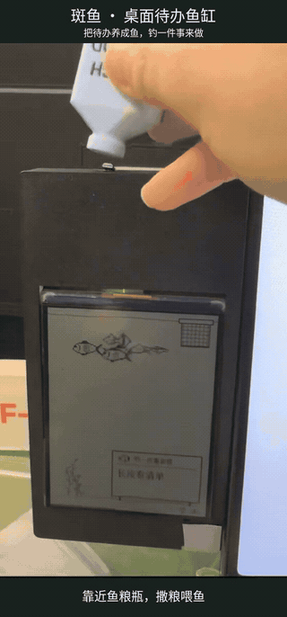

# 斑鱼 · 桌面待办鱼缸

**把待办养成鱼，钓一件事来做。**

放在显示器旁的一只黑白像素小鱼缸。平时，小鱼在水草间游来游去；想开始做事时，把磁铁鱼竿靠近屏幕，等鱼咬钩再提起，就抽到了一件待办。

钓到的鱼住进右上角的鱼护，旁边的小牌子写着你正在做的事。在网页或个人助手“大圣”里完成并发布后，这条鱼就会消失。想把它放回去？喂一次鱼，它会游回池子，牌子也恢复初始状态，任务留着下次再钓。

## 实物演示

[查看／下载35秒MP4演示](docs/media/banyu-demo.mp4)。上方为精选动态预览；实拍片段正常速度播放，已添加操作字幕、遮挡真实任务文字并移除环境音。

## 怎么玩

| 动作 | 鱼缸里会发生什么 |
| --- | --- |
| 添加待办并发布 | 每件未完成事项变成一条小鱼 |
| N极靠近，或短按KEY | 撒下鱼粮；鱼护有鱼时，先把它放回池子 |
| S极靠近，等咬钩后拿开 | 等概率钓出一件重点或杂项，自动放进鱼护 |
| 在大圣或网页完成并发布 | 对应任务鱼消失，鱼护空出来 |
| 长按KEY | 主动查看完整待办清单，再长按回到鱼缸 |

缸里始终有“思、闪、点”3条常驻鱼，它们不对应任务，也不会被钓走。新增的任务鱼有6种黑白像素造型，鱼身不写内容；钓起来才揭晓，一次只留一件正在做的事。

## 清单很简单

三份清单：**今日重点、今日杂项、今日追踪**。重点和杂项合并后按每件任务等概率抽取，追踪只展示为鱼、不参与抽取。没有项目层级，也不替你判断优先级。

未完成事项自动保留。钓中不等于完成，喂鱼放回也不删除任务。编辑先保存草稿，明确发布后才更新设备；长文字保留原文并分页显示。

## 桌上的设备

基于 **Waveshare ESP32-S3-RLCD-4.2**，使用300×400竖向全反射屏，以黑白像素呈现鱼、水草、鱼护和任务牌。SS49E线性霍尔传感器识别磁铁两极，完成喂鱼与钓鱼；按键提供备用操作。

设备通过Wi-Fi／热点独立连接私有待办服务，Mac无需一直开着。断网仍能喂鱼、钓取已缓存的任务；恢复联网后获取最新发布。大圣通过Skill生成候选，收到本人确认后再发布，网页也使用同一份清单。

## 当前进展

钓任务、鱼护、任务牌和喂鱼放回已实现、烧录，并获得使用者的实物效果确认。设备动画实测约11帧／秒，原清单与校准保留。长时间运行、反复磁感应和完整通信恢复测试仍在继续，详细范围见验证记录。

## 代码与开始使用

**当前已验收的实现位于 [`codex/aquarium-prototype`](https://github.com/cccpn7/rlcd-todo/tree/codex/aquarium-prototype) 分支。** `main`目前保留初始项目骨架；请切换到开发分支查看固件、网页、原型与最新文档。

- [完整README与运行入口](https://github.com/cccpn7/rlcd-todo/tree/codex/aquarium-prototype/README.md)
- [钓任务产品方案](https://github.com/cccpn7/rlcd-todo/tree/codex/aquarium-prototype/docs/task-fishing-product-draft.md)
- [网页交互原型](https://github.com/cccpn7/rlcd-todo/tree/codex/aquarium-prototype/prototypes/task-fishing)
- [硬件与接线资料](https://github.com/cccpn7/rlcd-todo/tree/codex/aquarium-prototype/docs/hardware.md)
- [开发、备份与烧录](https://github.com/cccpn7/rlcd-todo/tree/codex/aquarium-prototype/docs/development.md)
- [设备直连与服务部署](https://github.com/cccpn7/rlcd-todo/tree/codex/aquarium-prototype/docs/remote-development.md)
- [验证记录与待测项](https://github.com/cccpn7/rlcd-todo/tree/codex/aquarium-prototype/docs/validation.md)

固件使用ESP-IDF / LVGL，服务使用FastAPI / SQLite，网页使用HTML、CSS和JavaScript。真实任务、网络配置、凭据与设备日志不进入公开仓库。

第三方驱动和字体保留原许可；本项目原创代码暂未选择许可证，详见[第三方说明](https://github.com/cccpn7/rlcd-todo/tree/codex/aquarium-prototype/third_party/README.md)。
